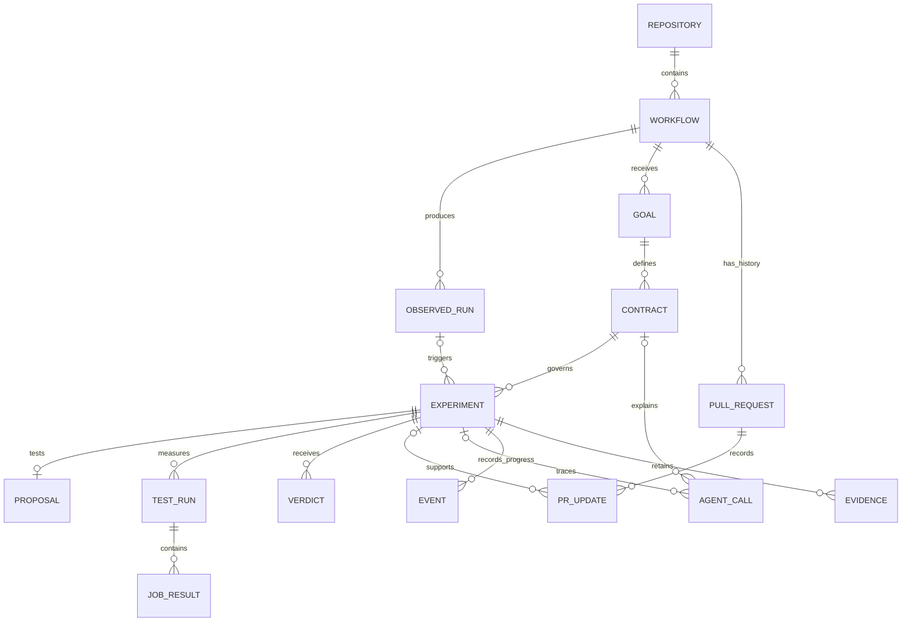

# CI improvement agent: working design

Status: architecture interview in progress. This is a decision record, not a claim of implemented features.

## Ready to build: decision boundary

Deployment update: Nathan wants the same deployment method as Shadow Runner. Reuse that operational setup rather than introduce a different hosting platform. The inspected reference repository documents `uv sync` and local `uv run python cli.py` commands, but no hosted deployment configuration was found. Actual prior hosting/startup details remain to be identified; do not assume a provider. This supersedes laptop-first as a fixed deployment requirement and does not block repository setup. Continuous watching is new behavior to add to the reused setup.

Nathan has ended detailed architecture interviewing for now. The core architecture is sufficient to start repository setup and implementation. Remaining tuning choices should be made during implementation, recorded briefly, and must not block setup. This document remains a working design; its proposed data model may be simplified as code takes shape.

Confirmed clock: wall-clock time from the earliest required-job start through the latest required-job completion, including waits between jobs. Initial GitHub queue delay is reported separately. Summed runner time is secondary diagnostic data. Use exactly three matched baseline/candidate run pairs per experiment on the same runner. A 5% gain qualifies as a win; report every measured effect, even below that threshold. All required jobs must pass; a fast failure is not a win. No GitHub Actions minute or elapsed-time experiment budget has been agreed.

Choose repetition counts, useful-gain thresholds, uncertainty calculation, polling interval and practical experiment caps while implementing against the selected demo repository. Save measurement rules before running the experiment; do not change grading after observing results. Ask Nathan only for material product choices or genuine blockers, not routine implementation tuning.

## Purpose

Build for the Done Means Done hackathon track. An agent team makes automated code checks (CI) faster and more efficient, defines success before changing anything, tests proposed changes, and provides evidence for a human to approve.

## Agreed direction

- Run continuously and watch GitHub rather than requiring a new manual goal for each experiment.
- Look for meaningful moments to act, such as a workflow change or evidence of a bottleneck. Exact triggers, rate limits and duplicate prevention are still to be defined.
- Improve CI workflows, not application performance.
- Candidate improvements include caching downloaded packages, changing job dependencies, running independent jobs in parallel, and selecting tests relevant to a code change.
- A job dependency graph (DAG) describes which jobs must finish before other jobs can start.
- Resource-aware execution is desired: observe machine usage and choose appropriate computing resources to balance speed and cost. Whether this includes changing resources during an already-running job is unresolved and depends on the execution platform.
- Emily researches candidate public demo repositories; Nathan approves feasibility before implementation. No demo repository has been selected.

## Important change to earlier planning

### First implementation scope, clarified

- Confirmed: resource telemetry is stretch; caching and parallelism are the first working features.
- Confirmed: inspect every completed run and experiment when a plausible improvement appears. One active experiment and one open optimization PR per workflow; deduplicate unchanged proposals. Opportunity thresholds and the overall concurrency/budget cap remain open.
- Prior project: https://github.com/NWelde/shadow-runner . Reviewed reference snapshot: `974366782efa7e7e27421d708c66f261b88b14ff`, cloned read-only for inspection under `.reference/shadow-runner`.
- Initial code inspection found existing GitHub ingestion, Python/Pydantic models, SQLite storage, job dependency analysis, a formatting-preserving dependency edit, baseline/candidate dispatch on a fork, and report generation. These are pre-existing foundations, not event-built achievements. Runtime correctness has not been tested in this review.
- Reuse needs care: the existing experiment runner automatically deletes a fork in its cleanup path. Do not carry that behavior into continuous monitoring without explicit ownership checks and a retained evidence policy. Its existing comparison must be reviewed before claiming sufficient repeated evidence.
- The new contribution should be identified explicitly: Crusoe-powered success-rule generation, proposing/verifying agent roles, continuous decision-making, bounded experiments, caching proposals and independently enforced completion gates, to the extent actually built during the event.

- Confirmed first optimizations: package caching and job parallelism.
- Nathan has earlier parallelism code that may be reused. Its location, license and boundary must be reviewed. Disclosure alone is not a promise of event eligibility: the supplied guide requires judges to clearly distinguish event-built features from prior work.
- Confirmed execution access: GitHub Actions only; no custom runner platform is available yet.
- Live resource allocation remains an interesting possible extension, not an accepted implementation promise. GitHub documents choosing runner hardware for jobs and autoscaling the number of runners, not adding cores to an already-running hosted job. We must not equate these capabilities.
- Useful possible extension: collect usage during a run, then recommend a different runner for a subsequent run, if eligible hardware and pricing are available. This has not been selected.
- Test selection remains unresolved; no answer was supplied for its verification policy. Existing full-test preservation stays in force for the first caching/parallelism implementation pending a deliberate decision.

Source: [GitHub larger-runner management](https://docs.github.com/en/actions/how-tos/manage-runners/larger-runners/manage-larger-runners). Larger-runner availability must be checked against the actual account plan and configuration.

Earlier boards and tickets used a manually started bounded loop and a blanket rule against skipping tests. These are provisional and need revision: the service should run continuously, while each experiment remains bounded. Selective testing is desired, but how we prove necessary tests remain covered is still an open design question. Until that rule is agreed, selective testing must not bypass the existing verification gate.

## Open architecture questions

### Coordinator and agent team, confirmed

- Initial deployment: a Python process on Nathan's laptop checks GitHub periodically and saves progress locally. Tests execute on GitHub Actions. A hosted service is a later deployment goal, not required for the first demo.
- Three separate roles use Crusoe Managed Inference. They may share a model, but receive different instructions and inputs; exact model choice is open.
- Planner: turns the improvement goal and project constraints into measurable success rules before an experiment starts.
- Improver: uses workflow evidence and past attempts to propose one caching or parallelism patch within those rules.
- Verifier: independently reviews the proposed change and measured results against the saved rules, explaining acceptance, rejection or missing evidence.
- Ordinary program code owns execution, persistent state, budget enforcement, repeat detection and measured pass/fail gates. An AI explanation cannot override a failed gate.
- Still unanswered: whether experiment-generated GitHub runs are excluded from new-idea triggers. They must always be collected as evidence; the trigger policy must be resolved before enabling the watcher.
- Storage decision: SQLite is confirmed for the first version. A local database file stores experiment history, saved progress and duplicate-prevention records. Poll interval, authentication, experiment budget and the success metric remain open.

### Plain-language flow

GitHub completes a run → laptop notices it → Planner defines success → Improver proposes an edit → code checks allowed changes → GitHub runs original and edited versions → code measures results → Verifier reviews evidence → open/update a PR only if the saved rules pass; otherwise retry, change approach or stop within limits.

### Repository and experiment policy, confirmed

- Create a new hackathon repository. Reuse selected Shadow Runner modules with attribution and preserve the applicable license. Document the source snapshot, copied files and event-built changes.
- Allow one active experiment per workflow. Different workflows may run experiments concurrently, subject to a still-open overall budget/concurrency cap.
- Do not re-test the same proposed edit against unchanged source and conditions. Persist a comparison key covering source version, workflow, patch and measurement conditions; explicitly requested additional samples belong to the same experiment.
- Maintain one optimization PR per workflow and update it rather than opening duplicates. If a human changes its branch, detect that before modifying it. Exact stale-PR behavior remains open.
- Coordinator runs on the laptop first; hosted deployment comes later. Experiment jobs run on GitHub Actions.

1. Which optimization types must work in the first demo, and which are later goals?
2. Do we control the machines executing jobs, or initially edit GitHub workflow instructions only?
3. What evidence makes it acceptable to omit an irrelevant test? Is a complete test run required before accepting such a change?
4. Which GitHub events and measured conditions start an experiment? How do we prevent noisy or repeated PRs?
5. How do separate proposing and verifying agents agree on measurable success rules?
6. Which runner, inference model, storage and deployment tools are actually available?

## Working references

- [Project Miro board](https://miro.com/app/board/uXjVEYyVkGY=/)
- [Demo Miro board](https://miro.com/app/board/uXjVEYyZlOc=/)
- [Linear project](https://linear.app/brojects/project/crusoe-hackathon-698e9807da1d)
- [Technical design ticket BRO-28](https://linear.app/brojects/issue/BRO-28/write-the-technical-design-and-component-interfaces)

## Technology stack: what each tool does

Confirmed means Nathan selected it. Proposed means a concrete recommendation awaiting review; no version or account capability is assumed.

| Part | Tool | Status | Plain-language job |
| --- | --- | --- | --- |
| Coordinator | Python process on laptop | Confirmed | Watches GitHub, schedules experiments and enforces limits. |
| Agent reasoning | Crusoe Managed Inference | Confirmed | Powers Planner, Improver and Verifier. Model and connection settings remain open. |
| Execution | GitHub Actions | Confirmed | Runs the original and edited workflow on real machines. |
| History and progress | SQLite | Confirmed | Saves results, current state and duplicate-prevention keys in one local database. |
| New project | New Git repository | Confirmed | Separates this event's work from attributed Shadow Runner modules. |
| Dependency setup | uv with a committed lockfile | Confirmed | Gives teammates the same installed Python packages. Reuse reference setup where sensible. |
| Validated data | Pydantic | Confirmed | Checks that agent answers and component messages have required fields and valid values. |
| GitHub connection | Existing requests-based REST client | Confirmed | Reads completed runs, starts experiments and creates/updates PRs. Extend reused client rather than adding a second one. |
| Workflow edits | PyYAML plus existing targeted text-edit helper | Confirmed | Understands job instructions while preserving unrelated formatting. Account for GitHub's `on` key parsing. |
| Job ordering | NetworkX / existing graph analysis | Confirmed | Finds which jobs must wait and which may run together. A graph is a map of jobs and their dependencies. |
| Operator commands | Click | Confirmed | Commands such as `watch`, `status`, `experiment` and `export`; live mode must never silently use simulated data. |
| Verification | pytest and Ruff | Confirmed | Checks meaningful failure cases and catches basic code-quality problems. |
| Evidence files | Local JSON, reports and exported logs | Confirmed | Keeps inspectable proof outside large database rows; SQLite stores paths, hashes and source links. |
| Dashboard / hosted server | Deferred | Not required | First version uses readable terminal output and GitHub evidence. |

Keep a single Python application and one SQLite writer initially. Do not introduce a message broker, separate microservices or a general agent framework unless a demonstrated requirement needs it. This is a proposed simplicity constraint, not a confirmed library choice.

Crusoe is the reasoning service; GitHub Actions supplies test machines. SQLite stores records; Pydantic checks their shape. These are distinct responsibilities.

## Proposed data model

### Success metric and context policy, confirmed

- Experiments and optimization PRs live entirely inside a dedicated fork controlled by the team. No upstream PRs are part of the first demo. Keep this fork and its evidence; do not inherit Shadow Runner's automatic fork deletion.
- Confirmed metric: wall-clock workflow completion time, with the changed version compared against the original version. This is elapsed time, not summed job durations. Exact start timestamp (workflow creation versus first job start) is still to be settled; report queue waiting separately either way.
- A historical previous run can reveal an opportunity, but a win should be established with fresh original/changed comparisons under matched conditions. A single faster run is not sufficient evidence by itself. Repetitions, minimum useful gain and confidence method remain open.

- Primary product claim: reduce workflow completion time and report seconds/minutes saved. Cost analysis is deferred; do not describe elapsed-time savings as proven money or total-compute savings.
- Confirmed precise measurement: elapsed wall-clock span from first required job start to last required job completion, with queue waiting reported separately. Three matched baseline/candidate run pairs are required. A 5% gain qualifies as a win, while all measured effects remain reportable. The uncertainty method still needs agreement.
- Experiment-generated runs are evidence only: tag their origin and exclude them from new-idea triggers. Observe ordinary completed runs for new opportunities.
- Give agents compact history summaries instead of replaying full logs: proposed edit, what worked or failed, why, measured effect and confidence interval when valid. Mark void/unmeasured outcomes explicitly; no interval is invented for invalid evidence.
- Keep full raw evidence separately and include references in summaries so the Verifier can inspect it when needed.
- Experiment budgets still constrain testing even though cost is not the primary optimization metric. Exact caps remain open.

### Proposed memory summary fields

`experiment_id`, `workflow_fingerprint`, `patch_fingerprint`, `idea`, `outcome`, `reason`, `effect_seconds`, `confidence_interval_seconds` (nullable), `method`, `sample_count`, `conditions`, `evidence_refs`.

Retrieve summaries relevant to the current workflow and edit type, under a bounded context size. Exact retrieval count is open. An earlier win is not proof the same patch works on changed code.

This graph is an implementation proposal awaiting review. An ID is a stable reference to a saved record. A fingerprint is a hash that identifies exact content without storing a second copy.

Read `one → many` as: one workflow can produce many completed runs. An experiment tests at most one proposed patch; revising the patch starts a linked new experiment. Repeated measurements of the same patch stay inside its experiment. Draft or rejected experiments may have no proposal, test run, verdict or PR yet.

| Record | Important fields | Why it exists |
| --- | --- | --- |
| Repository | id, GitHub repository ID, owner/name, default branch | Identifies the monitored code project. |
| Workflow | id, repository_id, GitHub workflow ID, path, last_seen_run cursor | Identifies one automated routine and where monitoring resumes. |
| ObservedRun | id, workflow_id, GitHub run ID, attempt, source SHA, workflow fingerprint, conclusion, timestamps, origin | Saves each completed run once. Origin distinguishes normal activity from our experiments; trigger treatment remains open. |
| Goal | id, workflow_id, text, constraints, created_at | Saves what we want to improve and what must remain true. |
| Contract | id, goal_id, version, immutable rules JSON, fingerprint, review status, created_at | Locks allowed edits, required tests, metrics, evidence method and limits before a proposal. |
| Experiment | id, contract_id, optional trigger_run_id, source SHA, workflow fingerprint, comparison_key, parent_experiment_id, status, stop_reason, budget counters | Tracks one bounded attempt and why it continued or stopped. |
| Proposal | id, experiment_id, hypothesis, optimization type, patch path/hash, expected effect, validation status/reasons | Captures the exact edit and its testable explanation. Expected gain is not measured gain. |
| TestRun | id, experiment_id, original/changed variant, pair_index, GitHub run ID/attempt, source/patch fingerprints, setup JSON, queue_seconds, execution_seconds, conclusion | Keeps every repeated measurement, including failures. Setup records runner/software and cache state. |
| JobResult | id, test_run_id, GitHub job ID, job/matrix identity, timing, conclusion, required-check status | Proves required jobs ran and shows which steps improved. |
| Verdict | id, experiment_id, evidence fingerprint, method/version, outcome, effect, uncertainty, checks passed, verifier explanation | Separates measured decision gates from the AI's explanation. Outcomes: win, loss, void, inconclusive. Keep prior evaluations when more samples arrive. |
| PullRequest | id, workflow_id, GitHub number/URL, state, branch, last_known_head SHA | Tracks review and prevents duplicate open optimization PRs. Human edits must be detected before updating. |
| PRUpdate | id, pull_request_id, experiment_id, commit SHA, action, timestamp | Connects each PR creation/update/review event to its evidence. Human feedback may have no experiment link. |
| AgentCall | id, role, model, prompt version, contract_id and/or experiment_id, input/output references, tokens/cost if available, timestamp | Records what Planner, Improver or Verifier contributed without exposing credentials. |
| Event | id, experiment_id, unique event key, state, reason, timestamp | Records transitions and permits safe resume without repeating actions. |
| Evidence | id, experiment_id, kind, local path or URL, fingerprint, captured_at, real/simulated label | Makes claims traceable to logs, reports, contracts and exact edits. |

### Integrity rules the implementation must enforce

1. A foreign key links a record to its parent; turn SQLite foreign-key enforcement on. Keep schema migrations versioned.
2. Uniquely identify imported runs by repository, GitHub run ID and attempt; polling again must not duplicate them.
3. Atomically claim one active experiment per workflow. Use a database transaction/unique active-workflow lock, not only a Python variable. Define stale-lock recovery before restart support is called complete.
4. The comparison key includes source, workflow, patch and measurement conditions. A unique key prevents a second identical experiment; additional samples extend the original. Different evidence rules require a new reviewed contract and an explicit superseding decision, not silent regrading.
5. A contract is immutable after an experiment starts. Changed rules create a new contract and experiment.
6. A publish action requires a current measured win tied to the exact patch/source/contract and passing required checks. An AI explanation cannot authorize a failed gate.
7. At most one open optimization PR per workflow; closed PRs remain in history. Reconcile actual GitHub state after restart.
8. Save external action intent before dispatch or publish; on retry reconcile with GitHub before repeating. A local unique key alone cannot guarantee an external action happened exactly once.
9. Preserve all samples, failures and earlier verdicts. Never discard unfavorable timings to manufacture a win.
10. Credentials stay in environment variables, outside database exports and prompt traces. Never delete experiment repositories or evidence just because an attempt ended.

### Example: how the records connect

One completed workflow run reveals slow package installation. The Planner saves a reviewed contract. The Improver saves a cache patch. One experiment contains multiple original/changed run pairs, with each job's result. The measured evaluator and Verifier produce a verdict. If it is a win, a PR update references that experiment; otherwise its failure or uncertainty remains available to the next proposal.

### Still to choose together

- Exact Crusoe model and client connection. Helper libraries in the stack table are confirmed; pin compatible versions during repository setup.
- Whether experiment-generated runs can trigger new ideas.
- Speed versus total machine-time success rule, useful-gain threshold and uncertainty method.
- Poll interval, authentication, per-experiment limits and overall concurrency/spend cap.
- Test-selection verification policy; not part of the initial caching/parallelism implementation.

