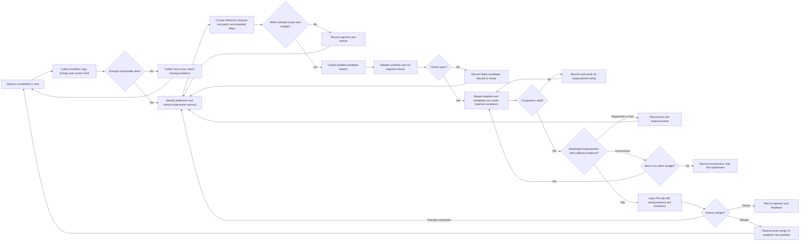
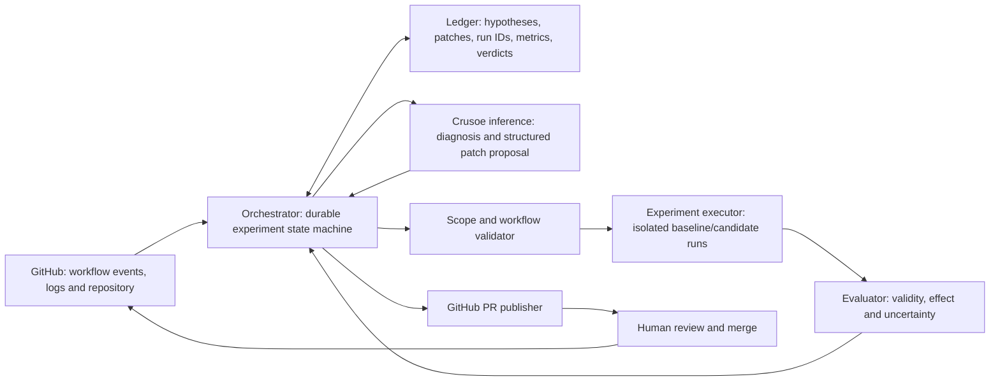

# Autonomous CI Improvement Agent — Hackathon Board

Board-ready draft based on the supplied concept image. All implementation choices below are proposed MVP defaults, not confirmed infrastructure capabilities.

## Board layout

Arrange five frames from top to bottom. Blue rectangles = actions; yellow diamonds = decisions; teal cards = memory/evidence; purple cards = implementation tasks. Solid arrows = execution; dashed arrows = feedback.

## Frame 1 — Product promise and scope

**Promise:** An agent powered by Crusoe inference observes CI, proposes one improvement, tests it against a baseline, and opens an evidence-backed PR when the improvement holds up.

**Proposed MVP:** One repository, one GitHub Actions workflow, one optimization type (dependency caching), one active experiment at a time. Human reviews and merges PRs.

**Success:** Demonstrate a real measured improvement with passing checks, a reviewable diff, and an experiment ledger that explains the result. Inconclusive experiments must be visibly inconclusive.

## Frame 2 — Runtime decisions

Place a teal **Structured memory / experiment ledger** bar beneath the entire flow. Connect every hypothesis, rejection, run, verdict, PR, and merge to it. Connect memory back to bottleneck selection and hypothesis generation. A merged PR changes the workflow the agent studies next.

### Decision cards

| Gate | Decision rule to define | Failure path |
|---|---|---|
| Enough data? | Workflow, runner class, timings, source revision and cache state are known | Collect missing evidence |
| Allowed experiment? | Allowed files/change types; maximum runs, elapsed time and spend | Reject or defer with reason |
| Checks pass? | Existing required checks still execute and pass; no reduced test coverage | Record failure; revise |
| Comparison valid? | Same source revision except patch; matched runner/environment; intentional cold/warm cache conditions | Void and rerun |
| Evidence of a win? | Predeclare metric, minimum useful improvement, repetition plan and uncertainty method | Loss or inconclusive |
| Ship? | PR contains reproducible evidence and passes repository checks | Human review |

Measure workflow duration as the primary MVP metric. Track job duration and failure rate as guardrails; show estimated cost only if pricing inputs are available. Separate queue time from execution time. Alternate or randomize baseline/candidate order to reduce time-related bias. Limit adaptive reruns with a declared stopping rule.

## Frame 3 — System responsibilities

Crusoe inference powers reasoning and patch proposals. The orchestrator schedules work; an executor runs CI; a deterministic evaluator decides whether the evidence satisfies the declared rule. The runner platform is an open choice. The reference image mentions StarSling Runners; confirm availability before making it a dependency.

**Ledger fields:** experiment ID, repository, source SHA, workflow hash, hypothesis, patch hash, expected effect, allowed scope, baseline/candidate run IDs, runner/environment, cache condition, metrics, uncertainty, verdict (win/loss/void/inconclusive), reason, budget consumed, PR URL, merge SHA, post-merge outcome.

## Frame 4 — Build order and completion checks

| Step | Build | Done when |
|---|---|---|
| 1 | Select demo repository and slow workflow | Workflow runs reproducibly; target bottleneck is measurable |
| 2 | CI collector and ledger | One run can be ingested and traced back to source SHA and logs |
| 3 | Baseline/candidate executor | A manually supplied patch produces a comparable measurement report |
| 4 | Evaluator | It handles win, loss, invalid comparison and inconclusive evidence |
| 5 | Crusoe inference adapter | It returns a structured hypothesis and a valid scoped patch |
| 6 | Orchestrator loop | It completes an experiment with limits, persists outcomes and avoids duplicate work |
| 7 | PR publisher | A confirmed win produces a PR with measurements, run links and caveats |
| 8 | Feedback and demo | Merge establishes a new baseline; a later proposal consults earlier outcomes |

Build and verify the measurement path before automating patch generation. This makes the agent's central claim demonstrable early.

## Frame 5 — Decisions to settle and demo script

### Proposed defaults / open decisions

- CI provider: GitHub Actions for the first integration.
- First improvement: dependency caching; select a repo where this has a plausible measurable effect.
- Execution: existing CI runners or confirmed isolated runner service.
- Inference: select available Crusoe model/endpoint; use structured outputs for hypothesis, patch and expected effect.
- Ledger: SQLite for a local single-worker demo; expand only if deployment needs it.
- Metric and evidence threshold: choose before running experiments; report the actual uncertainty.
- Autonomy: observe, propose, experiment and open PR autonomously; human merges.
- Limits: workflow-scoped edits, unchanged required checks, bounded runs/time/spend, one active experiment.

### Demo story

1. Show the slow workflow and its baseline evidence.
2. Show the agent finding a bottleneck and proposing a scoped patch through Crusoe inference.
3. Show matched baseline/candidate runs and the evaluator's verdict.
4. Show the generated PR with diff, effect, uncertainty and links to runs.
5. Show a rejected or inconclusive experiment retained in memory.
6. Show merge feedback updating the baseline and influencing the next hypothesis.

### PR evidence card

Problem → hypothesis → exact diff → experiment conditions → baseline/candidate results → effect and uncertainty → required checks → limitations → reproduction links.
